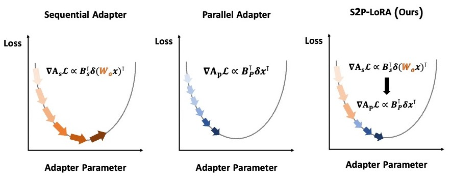

# S2P-LoRA

Official implementation of **Sequential-to-Parallel Low-Rank Adaptation via
Function-Preserving Projection**.

S2P-LoRA starts with a sequential low-rank adapter that receives the frozen
pretrained activation, then converts it to an ordinary parallel LoRA adapter at
a normalized training progress. The conversion preserves the represented
function and the final adapter can be merged into the base weight for
zero-overhead inference.



## What is included

- The function-preserving core-SVD projection.
- A standalone `S2PLoraLinear` layer for square and rectangular projections.
- Automatic injection into Hugging Face models.
- `S2PLoraTrainer`, including optimizer-parameter replacement and optional
  momentum reset at the switch.
- Clean NLU and NLG training entry points using S2P-LoRA only.
- Compact adapter checkpoints, merge utilities, paper configurations, and
  regression tests.

Baseline implementations and internal experiment orchestration are intentionally
not included. This repository has one execution path: S2P-LoRA.

## Method

For a frozen weight `W0`, the sequential phase learns factors `(B_s, A_s)`:

```text
W0 x + B_s A_s (W0 x).
```

At normalized progress `t_sw`, S2P-LoRA constructs parallel factors satisfying

```text
B_p A_p = B_s A_s W0,
```

and continues training as

```text
W0 x + B_p A_p x.
```

The implementation uses QR factorizations and an `r × r` core SVD instead of
decomposing the full update matrix. The balanced split is
`B_p = Q_B U sqrt(S)` and `A_p = sqrt(S) Vh Q_X^T`.

## Installation

Python 3.10 or newer is required. Commands below start from a clean clone.

```bash
git clone https://github.com/merrybabyxmas/S2P-LoRA.git
cd S2P-LoRA
python3 -m venv .venv
source .venv/bin/activate                 # Linux/macOS
# .venv\Scripts\activate                  # Windows PowerShell
python -m pip install --upgrade pip
```

On minimal Ubuntu images, install the OS venv module first if `ensurepip is not
available`:

```bash
sudo apt-get update && sudo apt-get install -y python3-venv
```

Install a PyTorch wheel appropriate for the machine, then install S2P-LoRA:

```bash
# CPU
python -m pip install torch --index-url https://download.pytorch.org/whl/cpu

# NVIDIA CUDA 13.0 (for example, RTX 50-series)
# python -m pip install torch --index-url https://download.pytorch.org/whl/cu130

python -m pip install -e ".[train]"
```

For other CUDA or ROCm versions, use the command generated by the official
[PyTorch installation selector](https://pytorch.org/get-started/locally/).

For tests and development tools:

```bash
python -m pip install -e ".[train,dev]"
```

For gated Hugging Face models such as LLaMA-2 or Gemma, request model access and
authenticate once:

```bash
hf auth login
```

## Verify the installation

These checks require no model download:

```bash
python examples/minimal_switch.py
python scripts/run_projection_test.py
pytest -q
```

The test suite covers square and grouped-query-attention shapes, BF16
rectangular switching, function preservation, optimizer replacement, parallel
checkpoint round trips, merging, and a real short `transformers.Trainer` run.

## NLU training

The supplied configuration matches the paper's DeBERTa-v3-base setup: rank 8,
`q/k/v` projections, learning rate `1e-4`, batch size 32, and switch ratio 0.5.
Task-specific epoch counts are selected automatically.

```bash
python scripts/train_glue.py \
  --config configs/nlu/deberta-v3-base.yaml \
  --task cola \
  --seed 42
```

Supported tasks are `cola`, `mnli`, `mrpc`, `qnli`, `rte`, `sst2`, and `stsb`.
Command-line arguments override the YAML configuration:

```bash
python scripts/train_glue.py \
  --config configs/nlu/deberta-v3-base.yaml \
  --task mrpc \
  --switch-ratio 0.3 \
  --seed 16
```

A short end-to-end smoke run is useful before launching a full experiment:

```bash
python scripts/train_glue.py \
  --config configs/nlu/deberta-v3-base.yaml \
  --epochs 1 \
  --max-train-samples 64 \
  --max-eval-samples 32 \
  --batch-size 8 \
  --eval-batch-size 8 \
  --output-root outputs/smoke
```

## NLG training

The NLG configurations reproduce the paper's common training setup: one epoch,
learning rate `2e-4`, effective batch size 16, rank 128, `q/k/v/o` attention
projections, and switch ratio 0.5. They use the public PiSSA training workloads
and make a deterministic 95/5 train/validation split.

```bash
# MetaMath workload
python scripts/train_causal_lm.py --config configs/nlg/metamath.yaml

# Python/CodeFeedback workload
python scripts/train_causal_lm.py --config configs/nlg/python.yaml

# Conversation/WizardLM workload
python scripts/train_causal_lm.py --config configs/nlg/conversation.yaml
```

Override the backbone without changing the training code:

```bash
python scripts/train_causal_lm.py \
  --config configs/nlg/metamath.yaml \
  --model mistralai/Mistral-7B-v0.1

python scripts/train_causal_lm.py \
  --config configs/nlg/metamath.yaml \
  --model google/gemma-7b
```

Run the complete NLG pipeline with a tiny public model and the bundled example
data before allocating a 7B job:

```bash
python scripts/train_causal_lm.py \
  --model hf-internal-testing/tiny-random-LlamaForCausalLM \
  --data-file examples/tiny_instructions.jsonl \
  --dataset-data-dir "" \
  --task-name smoke \
  --precision float32 \
  --no-gradient-checkpointing \
  --rank 2 --alpha 2 \
  --batch-size 2 --eval-batch-size 2 \
  --gradient-accumulation-steps 1 \
  --epochs 1 --eval-steps 1 \
  --max-seq-length 64 \
  --output-root outputs/smoke
```

The 7B configurations require a CUDA GPU with sufficient memory. Reduce
`--batch-size`, increase `--gradient-accumulation-steps`, or choose a smaller
backbone when memory is limited. Quantized base layers are not currently
supported because the public injector targets `torch.nn.Linear` modules.

## Output layout

Every run uses the same collision-safe hierarchy:

```text
outputs/
└── nlu/
    └── cola/
        └── microsoft--deberta-v3-base/
            └── s2p-r8-sw0.5/
                └── seed-42/
                    ├── config.json
                    ├── best_adapter.pt
                    ├── best_metric.json
                    ├── final_adapter.pt
                    ├── metrics.json
                    └── trainer/
```

NLG runs use the same structure below `outputs/nlg/<workload>/...`.

- `config.json`: resolved command, runtime versions, data sizes, adapted modules,
  and trainable parameter counts.
- `best_adapter.pt`: best post-switch validation adapter.
- `final_adapter.pt`: adapter at the final optimization step.
- `best_metric.json`: metric, value, and global step used for selection.
- `metrics.json`: train/final metrics and the recorded switch event.

Existing non-empty run directories are never silently reused. Pass
`--overwrite-output` explicitly when a rerun should use the same path.

## Python API

```python
from transformers import AutoModelForSequenceClassification
from s2p_lora import inject_s2p_adapter, load_adapter, merge_adapters

model = AutoModelForSequenceClassification.from_pretrained(
    "microsoft/deberta-v3-base",
    num_labels=2,
)
inject_s2p_adapter(
    model,
    ["query_proj", "key_proj", "value_proj"],
    r=8,
    lora_alpha=8,
    modules_to_save=["classifier", "pooler"],
)
load_adapter(model, "outputs/.../best_adapter.pt")
merge_adapters(model)  # requires a post-switch/parallel checkpoint
```

For custom training loops, `S2PLoraLinear.switch_to_parallel()` returns any
`(old_parameter, new_parameter)` pairs created by rectangular layers. Replace
those references in the optimizer. `S2PLoraTrainer` handles this lifecycle
automatically.

## Repository layout

```text
src/s2p_lora/       projection, layer, injection, trainer, checkpoint API
scripts/            projection check and NLU/NLG training entry points
configs/nlu/        paper NLU configuration
configs/nlg/        MetaMath, Python, and conversation configurations
examples/           minimal switch example with no external downloads
tests/              unit and Trainer integration tests
assets/             method overview used by this README
```

## Reproducibility notes

- `switch_ratio` always means `global_step / max_steps`, independent of task
  length or epoch count.
- The default main-experiment switch ratio is 0.5.
- NLU uses rank 8 on DeBERTa `q/k/v`; NLG uses rank 128 on decoder
  `q/k/v/o` projections.
- Random seeds are applied to Python, NumPy, PyTorch, CUDA, Trainer data order,
  and dataset splitting.
- The best checkpoint and final step are stored separately. Paper-style model
  selection uses `best_adapter.pt`; trajectory analysis should use
  `final_adapter.pt` explicitly.
- Adapter checkpoints contain trainable heads but never duplicate the frozen
  base model.

## License

This repository is released under the [MIT License](LICENSE).

## Citation

The proceedings BibTeX will be added when the accepted paper receives its
final bibliographic record. Please cite the paper title in the meantime:

> *Sequential-to-Parallel Low-Rank Adaptation via Function-Preserving Projection*
